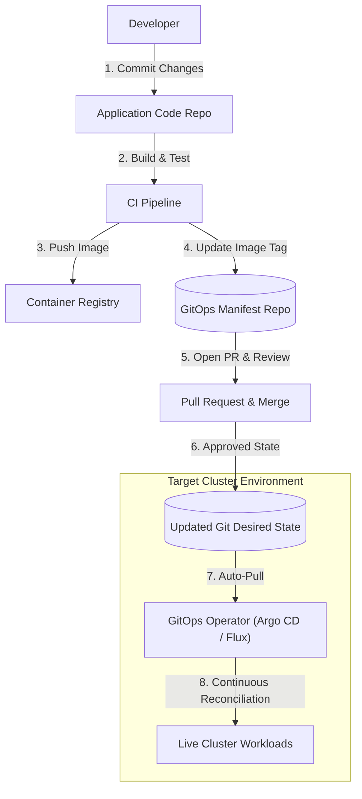

# GitOps Documentation

  

---

# Author Table

| **Author** | **Created On** | **Version** | **Last Updated By** | **Last Edited On** | **L0 Reviewer** | **L1 Reviewer** | **L2 Reviewer** |
| ---------- | -------------- | ----------- | ------------------- | ------------------ | --------------- | --------------- | --------------- |
| Shivam Tomar | 11-09-2026 | v1.0 | Shivam Tomar | 22-09-2026 | Ishaan | Anuj Jain | Piyush Upadhyay |

---

# Table of Contents

1. [Introduction](#1-introduction)
2. [What is GitOps?](#2-what-is-gitops)
3. [Why GitOps is Required](#3-why-gitops-is-required)
4. [GitOps Core Principles](#4-gitops-core-principles)
5. [GitOps Tools](#5-gitops-tools)
6. [GitOps Workflows and Procedures](#6-gitops-workflows-and-procedures)
7. [Benefits of GitOps](#7-benefits-of-gitops)
8. [Challenges and Considerations](#8-challenges-and-considerations)
9. [Best Practices](#9-best-practices)
10. [Conclusion](#10-conclusion)
11. [Contact Information](#11-contact-information)
12. [References](#12-references)

---

# 1. Introduction

This document provides a simple and practical overview of GitOps, explaining how it works, why teams use it instead of traditional deployment pipelines, its core rules, tools, standard workflow, benefits, and challenges.

---

# 2. What is GitOps?

GitOps is a modern way of managing and deploying infrastructure and applications where the Git repository is the single source of truth. In GitOps, the desired state of your entire system is written as configuration files in Git. An automated agent running inside your Kubernetes cluster continuously checks Git and automatically updates the live environment whenever changes are made.

---

# 3. Why GitOps is Required

In traditional setups (Push-based CI/CD), external build servers like Jenkins or GitHub Actions connect directly to production clusters using admin passwords or tokens to deploy changes manually.

### Common Problems with Traditional Push Pipelines:
* Security Risks: Storing high-privilege cluster admin credentials inside external CI/CD tools increases the risk of security leaks.
* Configuration Drift: When engineers make direct manual changes on servers or clusters, the live system stops matching the code stored in Git.
* Slow Recovery: Fixing or rolling back a bad deployment requires running complicated recovery scripts or re-building pipelines from scratch.

---

# 4. GitOps Core Principles

GitOps is built on four core principles defined by the CNCF OpenGitOps standard:

| **Principle** | **Description** |
| ------------- | --------------- |
| **Declarative Description** | The entire system setup is written in clean configuration files (like YAML) describing what the system should look like. |
| **Version Controlled in Git** | All configuration files are stored in Git, giving a complete history of who changed what and when. |
| **Automatically Pulled** | Software agents inside the cluster automatically read approved changes from Git without needing external push access. |
| **Continuously Checked and Fixed** | The agent constantly compares the live cluster with Git and automatically fixes any differences (drift). |

---

# 5. GitOps Tools

GitOps relies on specialized in-cluster tools that continuously sync Git configurations with live environments:

| **Tool** | **Primary Use** | **Key Feature** |
| -------- | --------------- | --------------- |
| Argo CD | Kubernetes application delivery | Provides a Web UI to see application status and automatically keeps the cluster in sync with Git. |
| Flux CD | Kubernetes GitOps delivery | Runs lightweight controllers inside the cluster to automatically pull changes from Git and apply them. |
| Rancher Fleet | Multi-cluster GitOps | Helps manage and deploy applications/configurations across multiple Kubernetes clusters from one place. |
| Weave GitOps | GitOps and Kubernetes management | Provides tools to manage Kubernetes applications using Git as the source of truth. |

Other commonly used supporting tools include Helm, Kustomize, SOPS, and External Secrets Operator.

---

# 6. GitOps Workflows and Procedures

### GitOps Workflow Architecture

### Standard Deployment Steps:
1. Update Application Code: Developer commits feature code to the application repository.
2. Build and Test Image: The CI pipeline runs automated tests, builds the container image, and pushes it to a container registry.
3. Update Deployment Manifest: A Pull Request is opened in the GitOps configuration repository to update the image tag.
4. Review and Merge: The team reviews, approves, and merges the Pull Request into the main branch.
5. In-Cluster Sync: The GitOps operator inside the cluster sees the new Git commit, pulls the updated file, and updates the running pods.

---

# 7. Benefits of GitOps

| **Benefit** | **Description** |
| ----------- | --------------- |
| Better Security | Cluster credentials are never shared with or stored in external CI tools. |
| Automatic Drift Correction | Automatically detects unauthorized manual cluster edits and restores the Git setup. |
| Quick and Easy Rollbacks | Roll back any broken change in seconds by reverting the Git commit. |
| Clear Audit History | Every infrastructure and application change is tracked with author name and timestamp in Git. |
| Simple Developer Experience | Developers deploy apps using standard Git Pull Requests without needing direct cluster access. |

---

# 8. Challenges and Considerations

| **Challenge / Consideration** | **Description** |
| ----------------------------- | --------------- |
| Managing Secrets | Passwords and API keys cannot be saved as plain text in Git; requires encryption tools. |
| Repository Management | Managing many environments (dev, staging, prod) can increase Git branch and PR complexity. |
| Strict Discipline Required | Direct manual changes on servers are not allowed; all edits must be committed to Git. |
| Tool Dependency | Smooth deployment depends on the GitOps agent running properly inside the cluster. |

---

# 9. Best Practices

| **Practice** | **Description** |
| ------------ | --------------- |
| **Separate App Code and Config Repos** | Keep application source code and deployment manifests in separate Git repositories to prevent unnecessary build triggers. |
| **Never Commit Plain Text Secrets** | Use tools like SOPS, Bitnami Sealed Secrets, or External Secrets Operator to encrypt sensitive data in Git. |
| **Enforce Pull Request Approvals** | Protect main branches and require peer code reviews before merging deployment changes. |
| **Enable Automated Drift Detection** | Configure GitOps operators to alert on or automatically fix unauthorized direct manual cluster changes. |

---

# 10. Conclusion

GitOps makes software delivery safer and faster by using Git as the single source of truth and automating deployments through in-cluster agents. This eliminates the need to expose cluster credentials and ensures that the live production environment always matches the approved code in Git.

---

# 11. Contact Information

| **Name** | **Email** |
| -------- | --------- |
| Shivam Tomar | [shivam.tomar.snaatak@mygurukulam.co](mailto:shivam.tomar.snaatak@mygurukulam.co) |

---

# 12. References

| **Resource / Standard** | **Official Reference Link** |
| ----------------------- | --------------------------- |
| OpenGitOps Standard & Principles | [opengitops.dev](https://opengitops.dev/) |
| Argo CD Official Documentation | [argo-cd.readthedocs.io](https://argo-cd.readthedocs.io/en/stable/) |
| Flux CD Official Documentation | [fluxcd.io/docs](https://fluxcd.io/docs/) |
