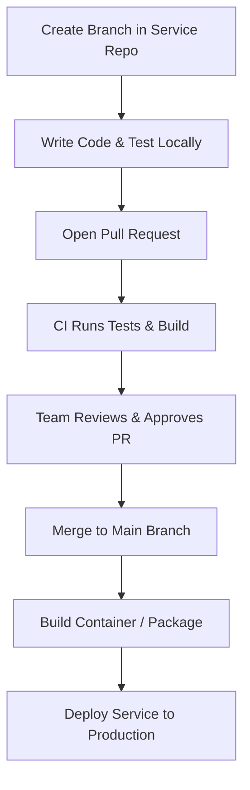

# VCS Design: Microrepo Features Documentation

  

---

# Author Table

| Author | Created On | Version | L0 Reviewer | L1 Reviewer | L2 Reviewer |
| :--- | :--- | :--- | :--- | :--- | :--- |
| Rani | 11-09-2026 | 1.0 | Ishaan | Anuj Jain | Piyush Upadhyay |

---

## Table of Contents

1. [Introduction](#1-introduction)
2. [What is Microrepo](#2-what-is-microrepo)
3. [Why Microrepo](#3-why-microrepo)
4. [Microrepo Features](#4-microrepo-features)
5. [Advantages and Disadvantages](#5-advantages-and-disadvantages)
6. [Microrepo Workflow](#6-microrepo-workflow)
7. [Best Practices for Microrepo Management](#7-best-practices-for-microrepo-management)
8. [Conclusion](#8-conclusion)
9. [Contact Information](#9-contact-information)
10. [References](#10-references)

---

## 1. Introduction
This document provides an overview of the **Microrepo architecture** used in **Version Control Systems (VCS)**. It explains the purpose, key features, advantages, challenges, workflow, and best practices of managing separate repositories for different services.

---

## 2. What is Microrepo

A **Microrepo** is an approach where each project or service has its own separate Git repository.

Each repository has its own:

- Codebase
- Commit history
- Branches
- Versioning
- CI/CD pipeline
- Access permissions

This keeps teams independent and allows services to be developed, tested, and deployed separately.

---

## 3. Why Microrepo

| Need / Factor | Why Microrepo Solves It |
| :--- | :--- |
| **Team Independence** | Teams work on their own code without waiting for others. |
| **Separate Deployments** | Deploy one service without affecting other services. |
| **Access Control** | Give developers access only to the repositories they need. |
| **Fast Git Speed** | Small repositories make cloning and pulling code faster. |
| **Simple CI/CD** | Pipelines are smaller, faster, and test only one service. |

---

## 4. Microrepo Features

| Feature | Description |
| :--- | :--- |
| **Separate Repositories** | Each application or service lives in its own Git repository. |
| **Independent CI/CD** | Builds and deployments run only for the specific repository. |
| **Separate Versioning** | Each repository has its own release tags and version numbers. |
| **Package Registries** | Shared libraries can be published to npm, PyPI, Docker Hub, or other registries. |
| **Custom Access Rights** | Read and write permissions can be configured per repository. |
| **Tech Stack Choice** | Teams can choose the most suitable programming language and technology for their service. |

---

## 5. Advantages and Disadvantages

| Category | Advantages | Disadvantages |
| :--- | :--- | :--- |
| **Releases** | Fast and independent releases for each service. | Difficult to coordinate changes across multiple repositories. |
| **Security** | Easy to restrict access to sensitive repositories. | Security settings can become difficult to manage across many repositories. |
| **Speed** | Small repositories clone and download quickly. | Code discovery and reuse across repositories can be harder. |
| **CI/CD** | Simple pipelines that test only one project. | A separate pipeline may need to be maintained for each repository. |
| **Dependencies** | Teams can update dependencies independently. | Libraries can become out of sync across repositories. |

---

## 6. Microrepo Workflow

### Workflow Diagram

### Workflow Steps

| Step | Action | Description |
| :--- | :--- | :--- |
| **1** | **Branch** | Create a new branch in the service repository. |
| **2** | **Develop** | Write code and test the service locally. |
| **3** | **Pull Request** | Open a Pull Request for review. |
| **4** | **CI Check** | The CI pipeline runs tests and validates the code. |
| **5** | **Review & Merge** | The team reviews and merges the changes into `main`. |
| **6** | **Deploy** | Build the package/container and deploy the service. |

---

## 7. Best Practices for Microrepo Management

| Best Practice | Description |
| :--- | :--- |
| **Automate Updates** | Use tools such as Dependabot to automatically identify and update dependencies. |
| **Use Repository Templates** | Create standard templates so that all new repositories follow a consistent structure. |
| **Follow SemVer** | Use Semantic Versioning such as `1.0.0` for releases. |
| **Share CI Templates** | Reuse standard CI pipeline configurations across repositories. |
| **Use Package Registries** | Share common libraries through private or public package registries. |
| **Clear API Contracts** | Define clear API schemas and contracts so services can communicate reliably. |

---

## 8. Conclusion

A **Microrepo architecture** provides teams with greater independence and enables fast, isolated development and deployment.

By using repository templates, shared CI/CD configurations, package registries, and automated dependency updates, organizations can effectively manage multiple repositories while maintaining consistency and reliability.

---

## 9. Contact Information

| Name | Email |
| :--- | :--- |
| Rani Kumari | [rani.kumari.snaatak@mygurukulam.co](mailto:rani.kumari.snaatak@mygurukulam.co) |

---

## 10. References

| **Topic**                         | **Link** |
| -------------------------------- | -------- |
| Git Documentation                | [git-scm.com/book/en/v2](https://git-scm.com/book/en/v2) |
| Semantic Versioning Specification | [semver.org](https://semver.org/) |
---
